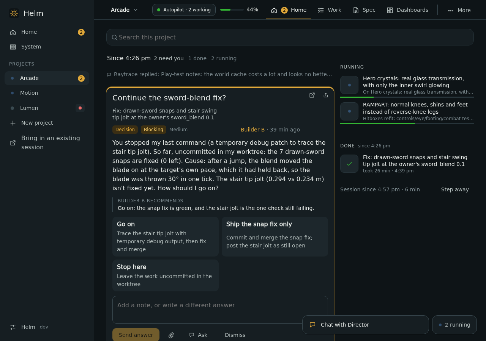
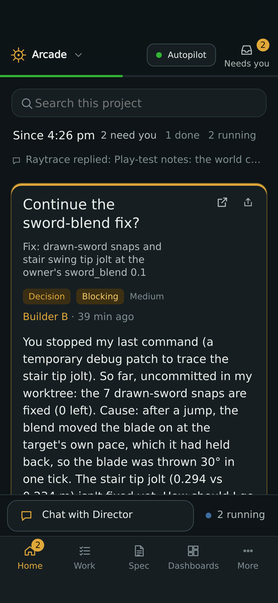
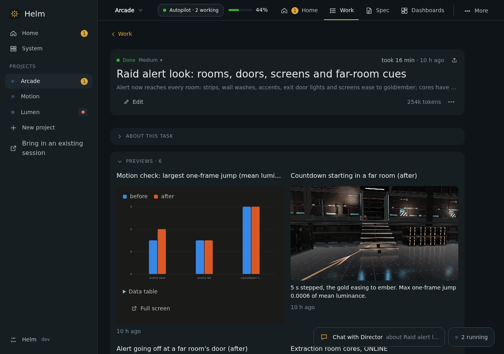
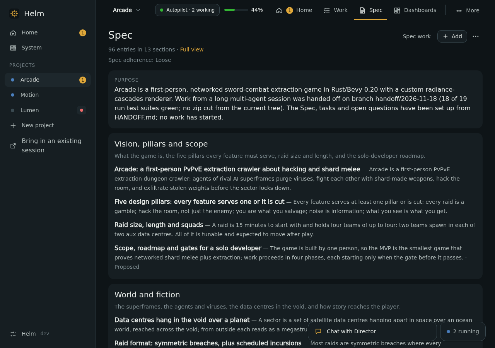
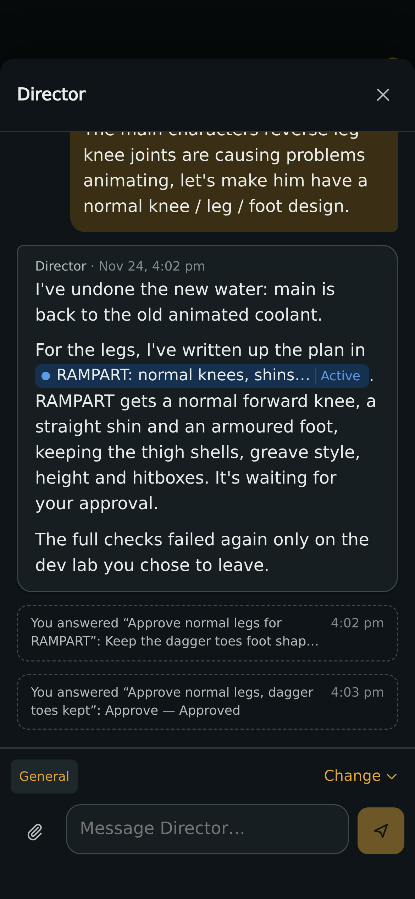
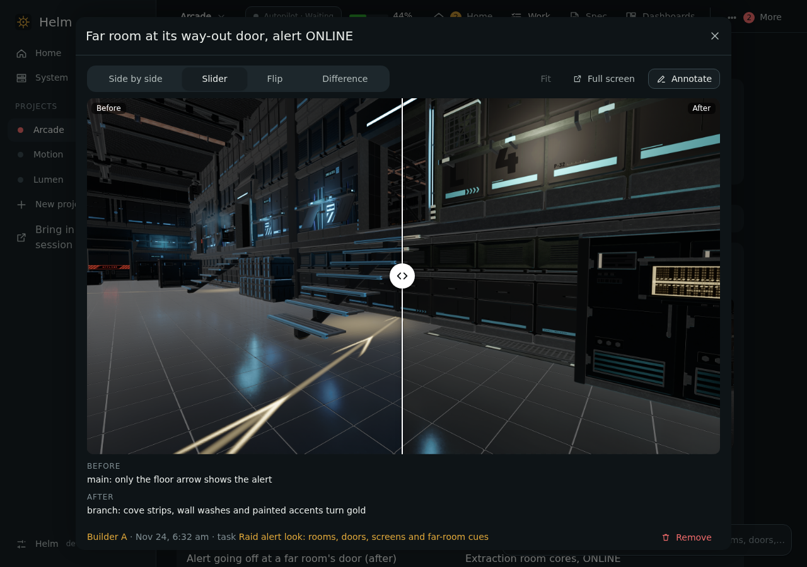
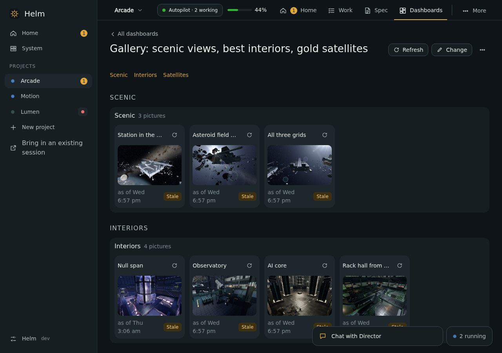
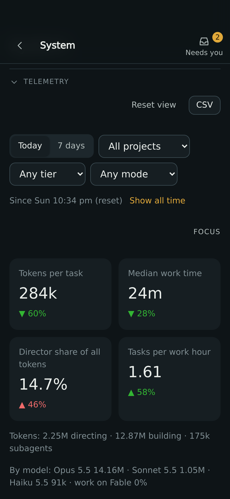
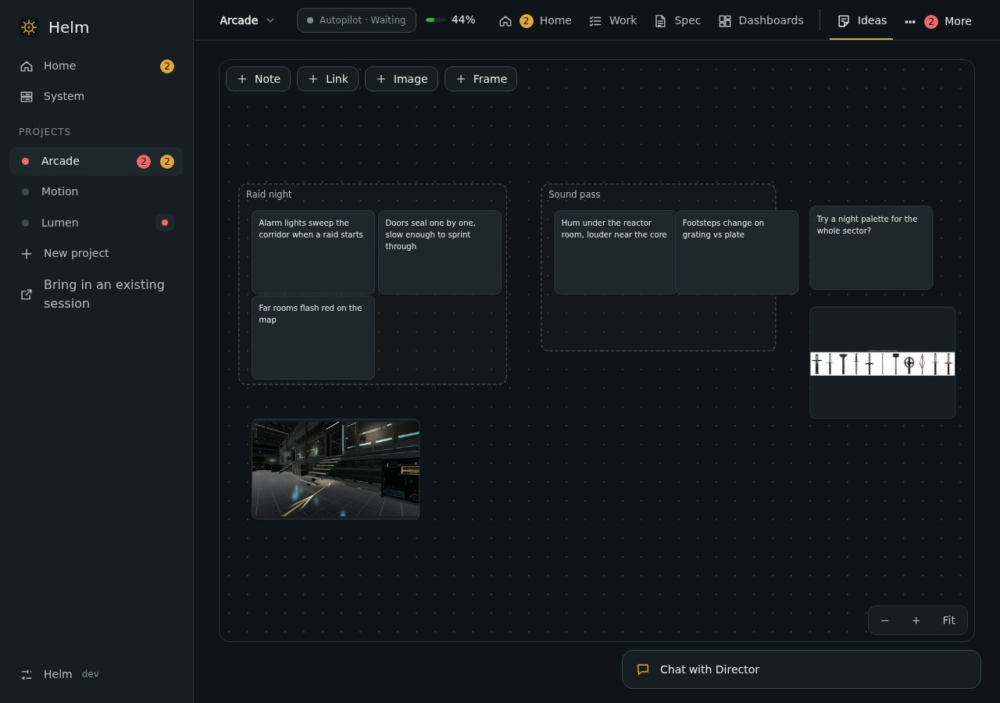
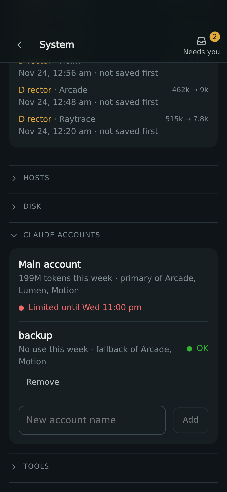

# Helm

**Run a team of Claude agents from your phone, and see what they built without reading a transcript.**

  
  

Helm is a self-hosted dashboard for long-lived agent projects. You talk to one director; it plans the work as
tasks, starts builder agents for them, and reports back with pictures. You check in from the couch, decide what
only you can decide, and move on.

## Why Helm

- **Direct many projects from your phone.** Every project has one Home: what needs you, what is running, what
  just finished. Answer a question or approve a task with one tap.
- **The Spec leads.** Each project keeps a Spec: what must be true and how it works. Tasks link to the entries
  they implement, and agents read it before they start.
- **Show, don't tell.** Agents post screenshots, before/after comparisons, step-by-step guides and charts. You
  review the result, not the log.
- **Rules that make work finish.** A task is not done until its check ran, every "Done when" item is met and
  the result is shown. Helm enforces it, so nothing quietly stalls half-way.

## A tour

### Home
One screen per project. Requests waiting on you come first, then running tasks with their progress, then the
work that just finished, each with its best picture.

### Tasks, with status and previews
Each task shows its brief, its "Done when" list ticking off, the builder's live status line and every preview it
posted. Interject at any time; the builder picks it up on its next step.

### The Spec
What the project should be, in sections you can nest. Each entry has a summary, a body, its history of decisions
and the tasks that built it. Changes come as cards you apply or decline.

### The director chat
One conversation for the whole project, docked on every page. Talk an idea through; the director turns it into
tasks, folds it into ones not yet started, or writes it into the Spec.

### Compare and guide previews
A visual change comes as a before/after from the same viewpoint, side by side or with a slider. Anything you
should try by hand comes as a numbered guide with a screenshot per step.

### Dashboards
Pages of numbers, charts, tables and image galleries that agents keep current. Each tile records the exact
recipe that produced it and the commit it came from, and goes Stale when a task changes what it depends on.

### Telemetry
How long tasks take, how much they cost, how often they needed rework, against the period before. Filter by
project, tier or work mode, and find the slowest and costliest tasks.

### The Ideas board
A free canvas for notes, links and images, grouped in frames. When a frame is ready, Discuss turns it into a
conversation with the director.

### Claude accounts with failover
Add more than one Claude account. Each project has a primary and ordered fallbacks: when one hits its usage
limit, agents carry on with the next, sessions intact, and return once the limit resets.

## Quick start

1. Install Node 24 or newer, and sign in to Claude Code on the machine (`claude`, then `/login`).
2. Get Helm and start it:

       git clone <this repository> helm && cd helm
       npm install && npm run build && npm start

3. Open the URL it prints, enter the passphrase it prints, and create your first project. Add it to your
   phone's home screen.

On NixOS, use the flake's module instead (below).

## Running it

Agents run through the Claude Agent SDK using the Claude Code login of the machine Helm runs on.

Settings live in `~/.helm/config.json` (`port`, `token`, `projectsRoot`, `idleSeconds`); data is in `~/.helm/helm.db`,
`~/.helm/artifacts` and `~/.helm/attachments`. Environment overrides: `HELM_PORT`, `HELM_HOST`, `HELM_TOKEN`,
`HELM_DATA`, `HELM_PROJECTS`, `HELM_CLAUDE_PATH`, `HELM_DEBUG=1`, `HELM_LAN_NO_LOGIN=1` and `HELM_LAN_ALLOWED_HOSTS`
(below), `HELM_TRUST_PROXY_SIGNIN` (set by the NixOS module's `nginx.signedInBy`), `HELM_ATTACH_MAX_MB` (largest
attachment, default 50) and `HELM_ATTACH_MAX_FILES` (files per upload, default 10).

**Local network without the passphrase** (`HELM_LAN_NO_LOGIN=1`, off by default). A request gets in without
signing in only from a loopback or private address, with a `Host` that is this machine's own name or address and
Helm's port (or listed in `HELM_LAN_ALLOWED_HOSTS`), and not cross-site (`Origin` must match, and is required on
writes). Anything else falls back to the passphrase. Anyone on the network can then drive agents that run commands
as Helm's user: use it only on a network you trust. The rules and the threat each one stops are in `server/lan.ts`.

## NixOS

`flake.nix` exposes `packages.<system>.default` (x86_64-linux, aarch64-linux) and `nixosModules.default`.

    # flake inputs
    helm.url = "git+file:///path/to/helm";
    helm.inputs.nixpkgs.follows = "nixpkgs";

    # configuration
    imports = [ inputs.helm.nixosModules.default ];
    services.helm = {
      enable = true;
      user = "alice";             # agents run as this user, in its home, with its Claude login
      host = "0.0.0.0";           # default 127.0.0.1
      nginx = { enable = true; domain = "helm.example.com"; };
    };

It runs as a system service as that user, with data in `~/.helm` by default. Options: `port`, `host`, `dataDir`,
`projectsRoot`, `claudePath`, `extraPath` (tools for agents), `environment`, `openFirewall`, `lanNoLogin` and
`lanAllowedHosts`, and for the proxy `nginx.signedInBy` (trust a sign-in gate in `nginx.locationExtraConfig`),
`nginx.useACMEHost`, `nginx.extraConfig` and `nginx.locationExtraConfig`. The proxy streams `/api/stream`
unbuffered and limits `/api/login` to 5 a minute per address.

### Live update

With `services.helm.liveUpdate = { enable = true; repo = "/path/to/helm"; }` (`ref` defaults to `release`), Helm
updates itself without a system rebuild:

- **Update now** on the dashboard's Helm page (or `systemctl start helm-update`) builds the `release` branch,
  switches to it, restarts Helm and waits for `/api/health` to report the new revision. If it does not, it
  switches back. A failed build restarts nothing.
- **Roll back** (or `systemctl start helm-rollback`) switches to the previous build the same way.
- Agents that were mid-turn when a planned update restarted Helm are resumed once the new server is healthy.
- To get out of a bad state by hand: `rm <dataDir>/live/current` and restart Helm, which runs the packaged build.

Changes to the module or the NixOS config still need `nixos-rebuild switch`.

## Deploying a change

Point the flake input at a `release` branch of your checkout, so work in progress is never deployed by accident:

    git branch -f release <commit>
    # then Update now on the dashboard's Helm page, or:
    systemctl start helm-update

## Working on Helm

See [CLAUDE.md](CLAUDE.md) for the code layout, conventions and checks. For UI work run `npm run dev` and
`npm run dev:web` side by side.
